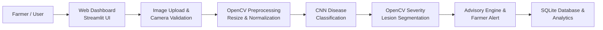

# AI-Based Crop Health Monitoring and Early Disease Detection System

[](https://python.org)
[](https://streamlit.io)
[](https://opencv.org)
[](https://keras.io)
[](https://sqlite.org)

**Mini Project Documentation Reference:**  
*AI3021 – Information Technology in Agriculture System*  
**Author:** DEVAKI K (Reg. No: 711023205007)  
**Supervisor:** Dr. K. Palani, M.E., Ph.D. (Professor & HOD)  
**Institution:** Info Institute of Engineering, Coimbatore • Anna University, Chennai  

---

## 🌾 Project Overview

The **Crop Health Monitoring and Early Disease Detection System** provides an AI-powered agricultural decision-support platform designed to assist farmers, agricultural extension officers, and agronomists in identifying visible plant foliar diseases at an early stage.

Late disease identification often causes severe yield loss and drives excessive, untimely pesticide usage. This project provides a farmer-friendly web application combining **OpenCV image preprocessing**, an optimized **multi-layer Convolutional Neural Network (CNN)**, quantitative **lesion severity segmentation**, and an automated **Farmer Alert and Treatment Advisory engine**.

---

## 🌟 Key Functional Modules

1. **🏠 Home Dashboard:** Key performance metrics (Total Scans, Healthy vs. Infected, AI Accuracy), project overview, and supported pathologies.
2. **📸 Crop Image Acquisition:** Supports local file uploads (JPG, PNG, JPEG), live webcam/smartphone camera capture, and a pre-loaded botanical sample gallery.
3. **🧠 CNN-Based Disease Detection:** Deep learning model with multi-scale feature extraction across 10 agricultural classes.
4. **📊 Disease Prediction Results:** Communicates predicted diagnosis, pathogen classification, confidence score (%), and clinical symptom profiles.
5. **🔬 Severity & Lesion Segmentation:** Quantifies percentage of infected leaf surface using OpenCV HSV color morphology and displays side-by-side diagnostic masks.
6. **🚨 Farmer Alert System:** High-visibility, color-coded alert banners (Emergency, Warning, Safe) with urgency indicators and spread risk.
7. **💊 Treatment Recommendations:** Integrated Pest Management (IPM) guidance categorized into Organic/Biological controls, Chemical Fungicides with precise dosages (e.g., Mancozeb 75% WP @ 2.5 g/L), and Cultural/Sanitation practices.
8. **📜 Detection History:** Persistent SQLite database logging timestamps, crop types, diagnoses, severity, and action status (Pending, In Progress, Resolved).
9. **📈 Analytics & Epidemiological Trends:** Interactive Altair charts for disease prevalence, severity distributions, and model validation metrics.
10. **ℹ️ About Project:** Complete documentation including system architecture diagrams, CNN layer specifications, and university project credentials.

---

## 🌿 Supported Crop Diseases

| Crop | Disease / Condition | Pathogen | Severity Profile |
| :--- | :--- | :--- | :--- |
| **Tomato** | Early Blight | *Alternaria solani* (Fungal) | Moderate (Target Rings) |
| **Tomato** | Late Blight | *Phytophthora infestans* (Oomycete) | Severe (Water-soaked) |
| **Tomato** | Healthy Foliage | None | Safe (0% Lesion) |
| **Potato** | Early Blight | *Alternaria solani* (Fungal) | Moderate |
| **Potato** | Late Blight | *Phytophthora infestans* (Oomycete) | Severe |
| **Potato** | Healthy Foliage | None | Safe (0% Lesion) |
| **Bell Pepper** | Bacterial Spot | *Xanthomonas campestris* (Bacterial) | High Threat |
| **Bell Pepper** | Healthy Foliage | None | Safe (0% Lesion) |
| **Corn (Maize)** | Common Rust | *Puccinia sorghi* (Fungal) | Moderate (Pustules) |
| **Corn (Maize)** | Healthy Foliage | None | Safe (0% Lesion) |

---

## 🏗️ System Architecture



---

## 💻 Tech Stack

- **Application Language:** Python 3.13
- **Web Dashboard:** Streamlit
- **Deep Learning / AI:** Convolutional Neural Network (CNN), TensorFlow/Keras architecture
- **Computer Vision:** OpenCV (`cv2`)
- **Database:** SQLite3
- **Data Analytics:** Pandas, NumPy, Altair

---

## 🚀 How to Run the Application

### 1. Install Dependencies
```bash
python -m pip install -r requirements.txt
```

### 2. Train and Evaluate the AI Model
```bash
python model/train_model.py
python model/model_eval.py
```

### 3. Launch the Streamlit Dashboard
```bash
streamlit run app.py
```

The application will automatically open in your web browser at:
`http://localhost:8501`
